# Généralités sur le module Fcm Central

Le module Fcm Central est un module métier de l'écosystème [POSEIDON](../../index.md). Il présente donc la plupart de ses fonctionnalités sous la forme de pages Web auxquelles l'utilisateur se connecte en utilisant son navigateur Web.

Comme son nom l'indique, le module FCM Central est destiné à outiller les processus définis dans la [Formation Continue Modulaire](https://portail-ct-mvl.intradef.gouv.fr/sites/FPS_Brest/FCM/Documents%20partages/DOCUMENTATION%20G%C3%89N%C3%89RALE/TEXTES/20230721_NP_DPMM_FORM_17638_Relative-mise-en-oeuvre-formation-continue-modulaire.pdf)

Le module FCM Central permet aux utilisateurs :

- de décrire les Parcours Professionnels en Alternance (PPA) de la Formation Continue Modularisée (FCM)
- de désigner les marins devant suivre les différents PPA
- d'historiser la progression de ces marins en enregistrant les éléments de ces PPA validés au cours du temps

Ces différentes fonctionnalités générales sont accessibles au travers de différentes pages Web.

## La description des PPA

Les pages permettant à l'utilisateur de décrire les parcours sont accessibles depuis le menu "Catalogue":

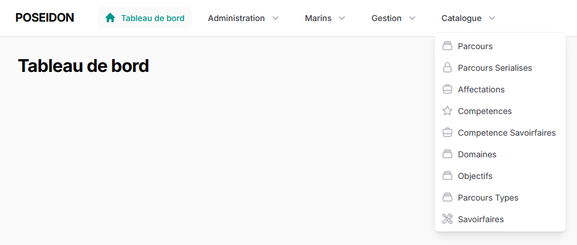

Pour rappel, voici un schéma illustrant comment sont construits les PPA:

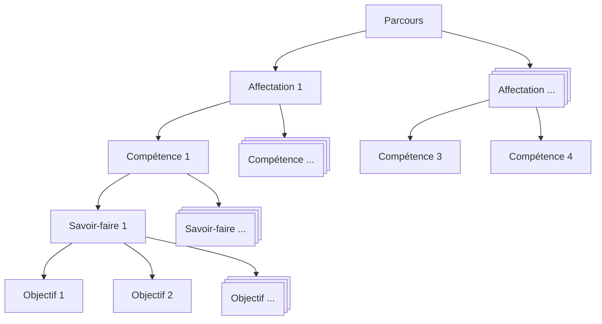

Les savoir-faire peuvent être de 3 types différents:

- des objectifs acquis par compagnonage
- des stages
- des modules d'enseignement à distance

Les objectifs sont les composants élémentaires du PPA.

## Création d'un nouveau Parcours

Pour créer un nouveau parcours, l'utilisateur doit accomplir les tâches suivantes:

### Créer un nouveau type de parcours si nécessaire

Le module FCM Central permet de définir des "Types de parcours", comme par exemple DEASM, ou ELECT. Ensuite, chaque parcours doit être associé avec un de ces types.
Cette implémentation permet, si on le souhaite, d'avoir plusieurs parcours d'un même type, par exemples plusieurs parcours de type DEASM.

Si le nouveau parcours ne correspond pas à un type de parcours existant déjà, créer le nouveau type de parcours:

!!! note

    L'accès aux pages listant les types de parcours et à la page de création d'un nouveau type de parcours n'est possible que pour les utilisateurs "Super-Administrateur" (voir la documentation de Skeletor relative aux [Comptes utilisateurs](../../Skeletor/administration/#comptes-utilisateur)). Si cette fonctionnalité (la possibilité d'avoir plusieurs parcours d'un même type) est confirmée, des permissions pouvant être attribuées aux utilisateurs seront définies pour régler les accès à ces pages.
    Si vous n'êtes pas "Super-Administrateur", vous ne verrez pas les menus et les pages indiquées ci-dessous.

Pour cela, depuis le menu Catalogue, utiliser le lien vers "Parcours Types".

Cliquer ensuite sur le bouton"Créer".

Et renseigner le formulaire permettant de définir le nouveau type de parcours:
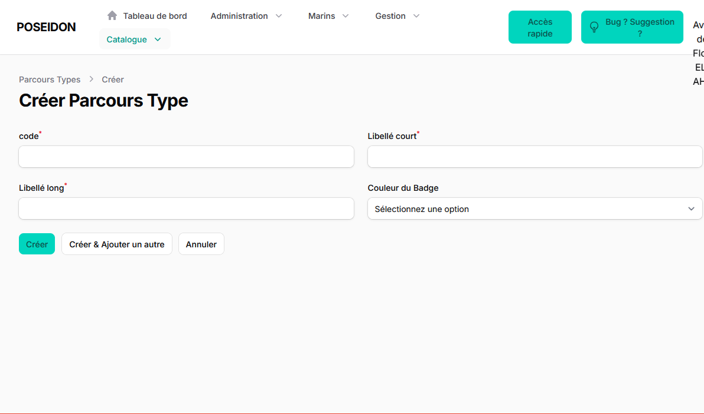

### Créer le nouveau parcours

Une fois le type de parcours créé (ou si le nouveau parcours est d'un type existant déjà), il est possible de créer le nouveau parcours en utilisant le lien "Parcour" du menu "Catalogue":

!!! note

    L'accès la la liste des parcours nécessite la permision fcmcentral::parcours.index. Si vous n'avez pas cette permission, le lien "Parcours" n'apparaitra pas dans le menu Catalogue.
    D'ailleurs, si vous n'avez accès à aucune des pages listées dans le menu Catalogue, ce dernier ne s'affichera même pas.

Ce lien amène à la liste des parcours déjà définis:

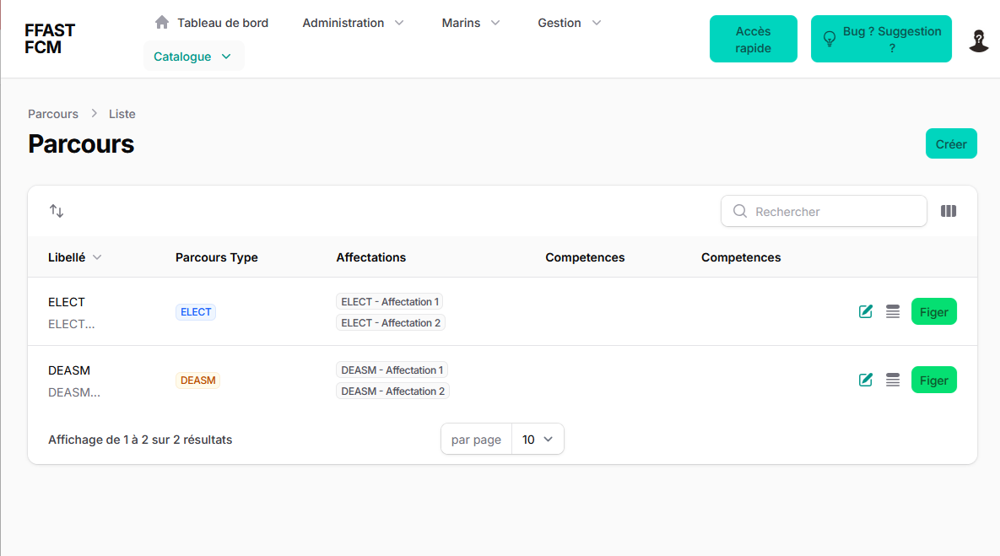

Cliquer ensuite sur le bouton "Créer" pour commencer la création du nouveau parcours:

!!! note

    L'accès à la fonctionnalité de création d'un parcours nécessite la permission fcmcentral::parcours.store

Renseigner le formulaire relatif au parcours:

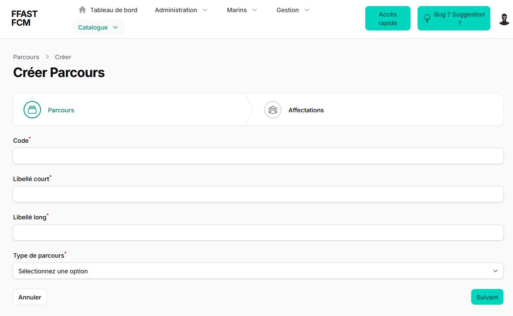

Cliquer sur "Suivant" et renseigner les informations relatives aux affectations pour lesquelles il faudra ensuite définir les compétences, savoir-faire et objectifs:

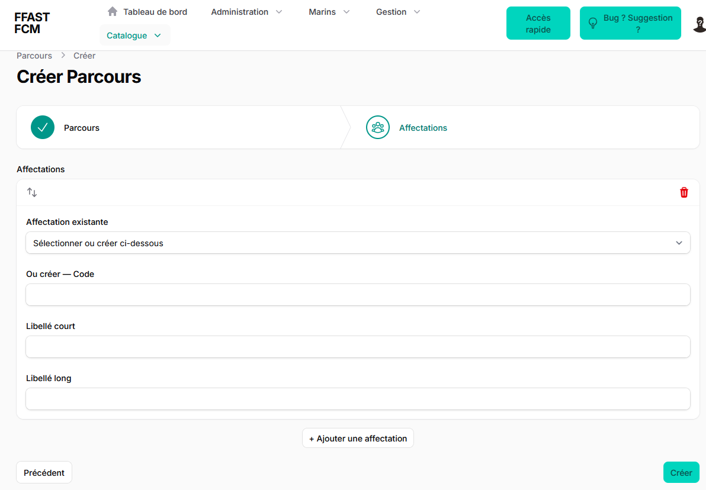

!!! note

    A cette étape, vous pouvez définir autant d'affectations que vous le souhaitez. Pour chaque affectation, vous pourrez ensuite définir des compétences à aquérir, des savoir-faire et des objectifs.

Une fois ces 2 étapes terminées (et après avoir cliqué sur "Créer"), le nouveau parcours existe dans la base de données. 

### Renseigner le contenu du nouveau parcours

Pour renseigner le contenu de ce parcours, naviguer à nouveau jusqu'à la liste des parcours depuis le menu Catalogue, et cliquer sur la ligne du nouveau parcours. Cela donne accès à la page d'édition du parcours.

!!! note

    Pour pouvoir éditer le contenu d'un parcours, l'utilisateur doit avoir la permission fcmcentral::parcours.update

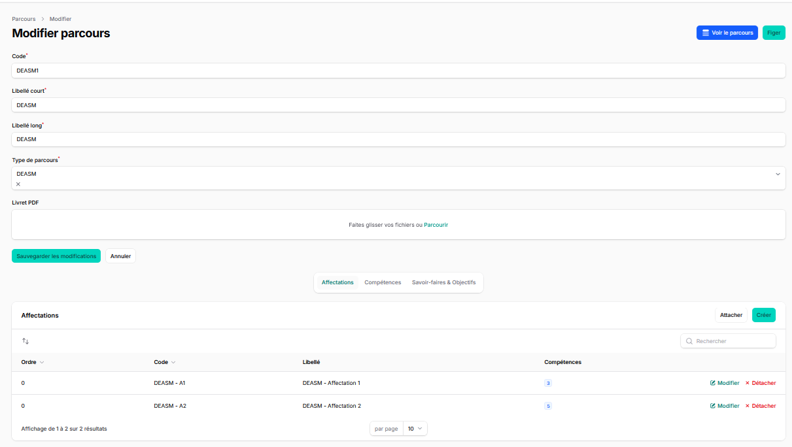

Depuis cette page, les onglets de la partie inférieure de la page permettent de définir:

- les affectations (pour corriger ce qui a été déclaré dans l'étape précédente si nécessaire)
- les compétences (en les associant avec l'affectation au cours de laquelle le PPA prévoit qu'elles soient acquises)
- les savoir-faire et leurs objectifs associés

!!! note

    Les onglets de la partie inférieures ne s'affichent que si l'utilisateur dispose des permissions suivantes:

    - fcmcentral::affectation.index: permet d'afficher l'onglet Affectations, d'attacher et de détacher des affectations du parcours en cours d'édition.
    - fcmcentral::affectation.store: permet à l'utilisateur de créér une nouvelle affectation (et comme il doit déjà avoir la permission ci-dessus, il peut l'associer au parcours en cours d'édition)
    - fcmcentral::competences.index: permet d'afficher l'onglet Compétences, d'attacher et de détacher les compétences existant déjà, et de créer de nouvelles compétences à associer au parcours en cours d'édition.
    - fcmcentral::competenceSavoirfaire.index: permet d'afficher l'onglet "Savoir-faire et objectifs", de modifier les données des savoir-faire et de leurs objectifs, y compris de créér de nouveaux objectifs ou d'en supprimer au sein de chaque savoir-faire.
    - fcmcentral::competenceSavoirfaire.store: permet de créer un nouveau Savoir-faire et de le rattacher à une compétence. L'onglet n'étant visible que si l'utilisateur dispose déjà de la permission ci-dessus, il peut ensuite ajuster le contenu de ce nouveau savoir-faire à sa guise.
    
Pour ce qui concerne les compétences, les savoir-faire et les objectifs, l'application propose à l'utilisateur:

- soit de reprendre un élément déjà défini dans l'application (par exemple si certaines compétences sont communes à 2 parcours distincts)
- soit de définir de nouveaux éléments

### Vérifier la définition du nouveau parcours depuis la vue détaillée

Depuis la liste des parcours ou depuis la page d'édition du parcours, il est possible d'atteindre la vue détaillée de celui-ci, qui permet d'afficher sur une seule page toute la définition d'un parcours donné.

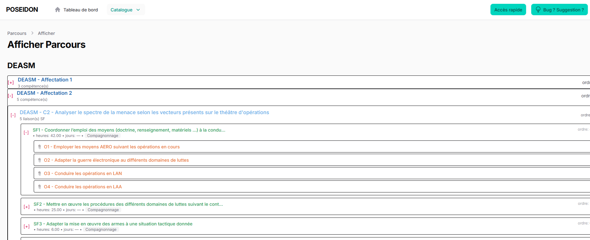

Les différents composants du parcours peuvent être développés grâce aux croix rouges situées à gauche.

### Figer une version d'un parcours

Dans le module de FCM Central, il y a une séparation stricte entre les outils permettant de décrire les parcours (objet des paragraphes précédents), et les outils permettant d'attribuer un parcours à un marin, puis de suivre sa progression.

En particulier, pour qu'une version du parcours entre effectivement en service, il faut en figer une version.

De la même façon que pour la vue détaillée, il est possible de figer la définition du parcours depuis la liste des parcours, ou depuis la page d'édition du parcours concerné.

!!! note

    L'utilisateur doit avoir la permission fcmcentral::parcours.figer pour pouvoir figer une nouvelle version d'un parcours

Après avoir cliqué sur le bouton "Figer", une boite de dialogue apparait pour que l'utilisateur puisse confirmer la date à partir de laquelle la nouvelle version entre en vigueur. Par défaut, cette date est fixée au lendemain.

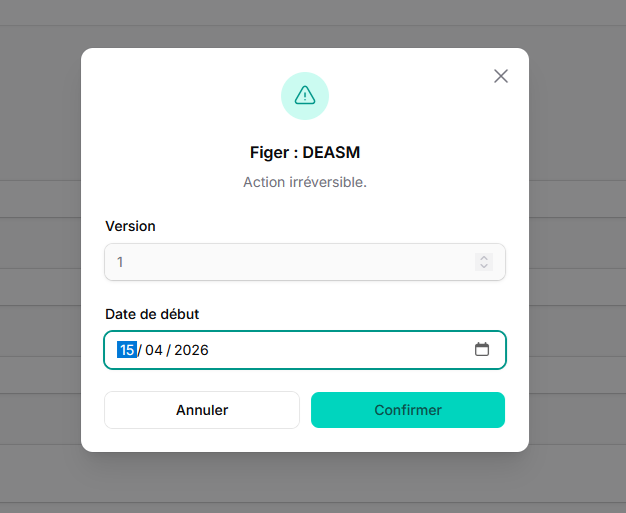

!!! note

    Dans l'écosystème général de POSEIDON, les unités disposeront de leur propre serveur POSEIDON, sur lequel sera déployé le module de suivi de la FCM. Ces modules devront disposer des définitions des différents parcours à jour. Par conséquent, la date d'entrée en vigueur des parcours figés ne peut pas être fixée rétroactivement dans le passé. Il est possible que la première date possible d'entrée en vigueur soit ultérieusement forcée quelques jours dans le futur (et pas dès le lendemain), afin de garantir que tous les serveurs POSEIDON aient eu le temps d'obtenir les dernières définitions avant l'entrée en vigueur de ces dernières.

## Gérer un marin dans le parcours de FCM

Afin de pouvoir suivre l'évolution d'un marin dans son cycle de FCM, il faut renseigner les informations relatives au parcours attribué à ce marin.

### Déclarer la cohorte BAT

La page de gestion des cohortes est accessible depuis le menu "Gestion".

!!! note

    Pour avoir accès à la page de gestion des cohortes en consultation, l'utilisateur doit avoir la permission fcmcentrall::cohorte.index

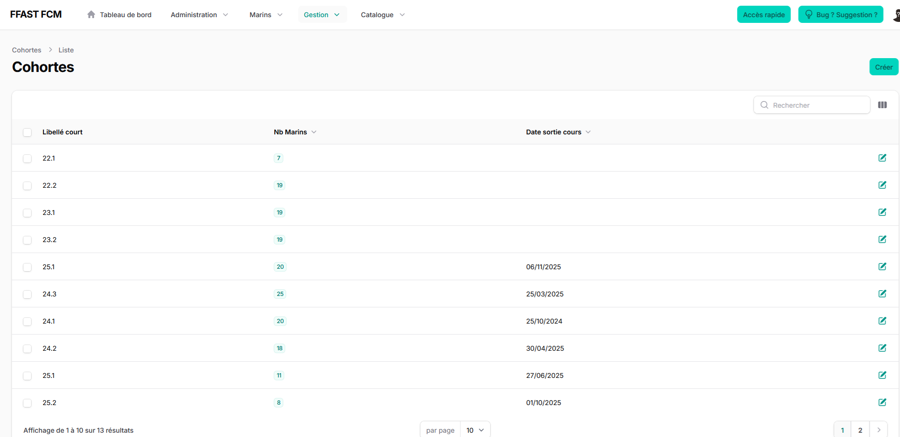

La page présente la liste des cohortes renseignées dans le module, et le nombre de marins associés à cette cohorte.

Le bouton "Créer" situé en haut à droite permet de déclarer une nouvelle cohorte.

!!! note

    La fonctionnalité de création d'une cohorte (et donc la visibilité du bouton associé) n'est accessible que si l'utilisateur a la permission fcmcentral::cohorte.store

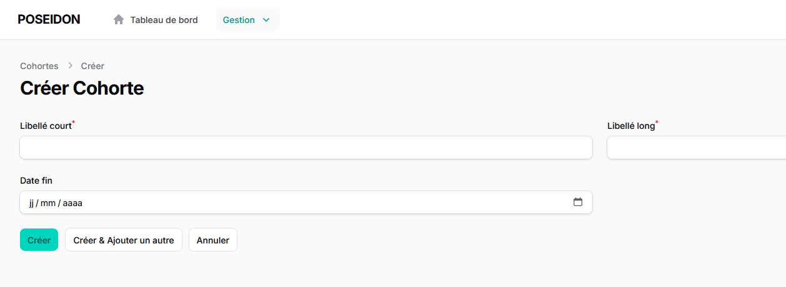

### Gérer les marins en FCM

Le module FCM Central expose la page de gestion des marins depuis laquelle les utilisateurs peuvent accéder aux principales fonctionnalités du suivi quotidien des marins en FCM.

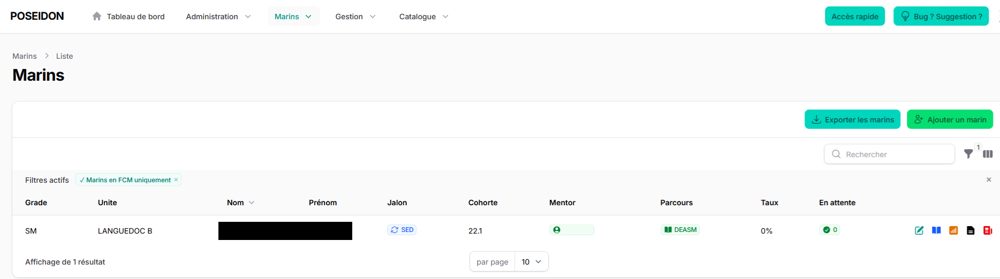

!!! note 

    L'utilisateur doit avoir la permission fcmcentral::marins.index pour pouvoir accéder à cette page. La liste des marins à laquelle il a accès dépend des règles de filtrage appliquées par le module RH. Se reporter à la documentation de ce module pour plus de détail.

    Les différentes fonctionnalités accessibles pour chaque marin dépendent de la situation de ce marin au regard de la FCM et des permissions accordées à l'utilisateur.

#### Placer le marin en FCM

Lorsque l'utilisateur accède à la page de gestion des marins, il peut indiquer au module FCM Central qu'un des marins disponibles dans la liste est dans le parcours de FCM.

Pour cela, il peut tout d'abord désactiver le filtre par défaut qui n'affiche que les marins déjà inscrits dans le parcours de FCM (en cliquant sur la croix dans la ligne des filtres actifs, pour le filtre "Marins en FCM uniquement", soit en cliquant sur le bouton des filtres (entonnoir à droite), et en désactivant le même filtre)

Une fois les marins affichés, l'utilisateur peut utiliser la barre de recherche située à droite pour rechercher le marin dont il souhaite s'occuper, si la liste est longue.

Il peut ensuite cliquer sur la croix rouge située dans la colonne FCM.

La boite de dialogue suivante apparaitra alors:

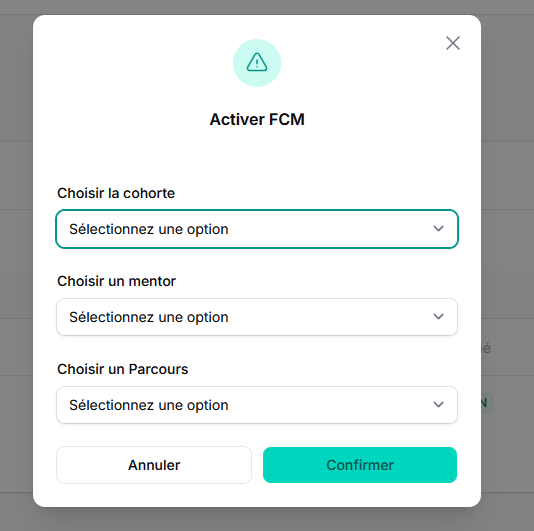

!!! note

    Dans cette boite de dialogue, les différents champs ne s'affiche que si l'utilisateur dispose des permissions correspondantes:

    - Choisir la cohorte: fcmcentral::attribuer.cohorte
    - Choisir le mentor: fcmcentral::attribuer.mentor
    - Choisir le parcours: fcmcentral::attribuer.parcours

    Si l'utilisateur n'a aucune de ces permissions, la boite de dialogue ne s'ouvre pas.

!!! note

    Dans cette boite de dialogue, ne s'affichent que les parcours qui disposent d'une version figée. Voir le chapitre "Figer une version d'un parcours" ci-dessus.

#### Période de sédimentation - Définition des jalons de FCM

Par défaut, lorsque le marin est placé en FCM, il est d'abord réputé entrer en période de sédimentation. Dans la page de gestion des marins, la mention "SED" apparait dans la colonne Jalon.

Avant de pouvoir saisir des données de progression dans son livret de FCM, il faut indiquer au logiciel que la période de sédimentation est terminée.

Pour cela, cliquer sur la mention "SED". La boite de dialogue de définition des jalons de FCM apparait:

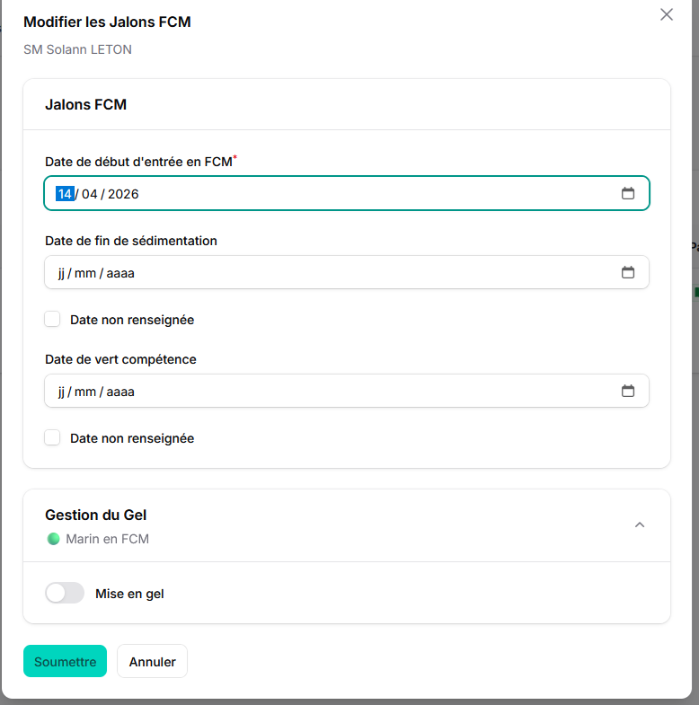

Cette boite de dialogue permet notamment de saisir une date de fin de sédimentation. Une fois la date saisie, le dossier de FCM du marin devient "actif" et l'utilisateur peut saisir des données de progression.

!!! note

    La boite de dialogue de définition des jalons de FCM n'est accessible que si l'utilisateur dispose de la permission fcmcentral::definir_jalons_de_fcm

Cette même boite de dialogue permet également, à la fin du parcours de FCM de signaler la fin de ce parcours pour le marin considéré, en saisissant la date du "Vert compétence", qui atteste que le marin a atteint ses objectifs de FCM.

Par ailleurs, lorsque le marin doit interrompre son parcours de FCM, il est possible de mettre celui-ci en gel. 
Lorsque le dossier d'un marin est mis en gel, il n'est plus possible de valider des éléments du parcours de FCM.
La définition des périodes de gel permet de mieux rendre compte de l'évolution des marins dans leur parcours de FCM.

#### Saisir la progression du marin - Le livret de FCM

Depuis la page de gestion des marins, il est possible d'accéder au livret de FCM individuel des marins engagés dans un parcours de FCM.

L'accès au livret de FCM n'est possible que si l'utilisateur dispose de la permission fcmcentral::livret.voir

!!! note

    L'accès est également possible sans autorisation particulière à tous les utilisateurs qui sont par ailleurs désignés comme mentor d'un marin dans le module de FCM. Cette permission est alors implicite et ne nécessite pas d'action d'administration sur le serveur.

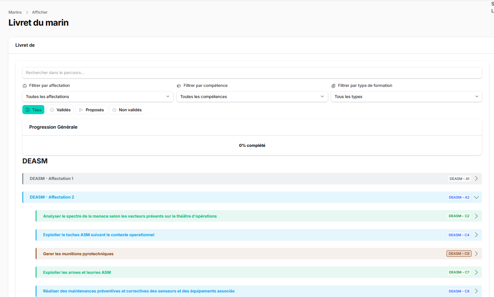

En outre, les différentes fonctionnalités du livret de FCM sont accessibles en fonction des permissions de l'utilisateur:

- valider un élément du parcours de FCM: possible si l'utilisateur a la permission fcmcentral::livret.valider
- annuler un élément du parcours de FCM: possible si l'utilisateur a la permission fcmcentral::livret.annuler
- refuser un élément du parcours de FCM proposé par le marin: possible avec la permission fcmcentral::livret.refuser
- proposer un élément du parcours à la validation: possible avec la permission fcmcentral::livret.proposer

!!! note

    Le mentor désigné d'un marin en FCM n'a besoin d'aucune permission particulière pour pouvoir valider, annuler ou refuser les propositions de validation. Ces permissions sont implicites, dès lors que l'utilisateur a été désigné comme mentor.

#### Imprimer le livret de FCM d'un marin

Depuis la page de gestion des marins, une petite icone noire permet à l'utilisateur d'exporter le livret de FCM sous forme de fichier PDF.

Cette fonctionnalité est accessible si l'utilisateur dispose de la permission fcmcentral::livret.telecharger.

#### Fiche Bilan

Depuis la page de gestion des marins, une petite icone orange permet à l'utilisateur d'accéder à la fiche Bilan d'un marin.

Cette fonctionnalité est accessible si l'utilisateur dispose de la permission fcmcentral::ficheBilan.voir.

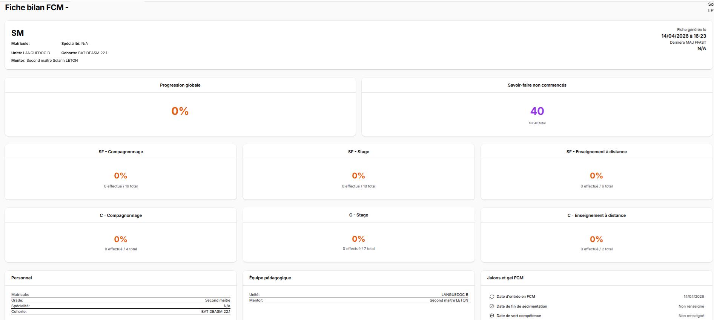

La fiche bilan présente en tout premier lieu des indicateurs généraux sur l'avancement du processus de FCM du marin considéré.

Puis dans une seconde partie, la fiche bilan fait la liste des éléments du parcours de FCM du marin.

Dans la partie droite, la fiche bilan présente les commentaires associés au dossier de FCM du marin.
Ces commentaires ne sont visibles que si l'utilisateur a la permission fcmcentral::note.voir

#### Commentaires

Depuis la page de gestion des marins, il est possible de rajouter un commentaire au dossier de FCM du marin. Cette fonctionnalité est accessible via une petite icone rouge située sur la ligne du marin considéré.

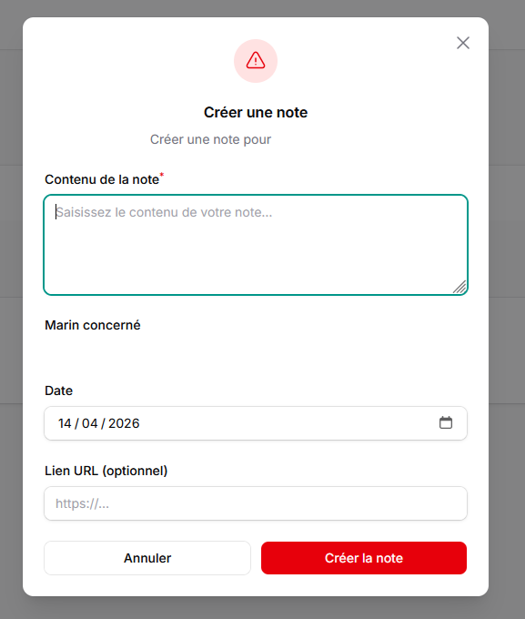

!!! note

    Cette fonctionnalité n'est accessible que si l'utilisateur dispose de la permission fcmcentral::note.creer

Ces notes sont consultables depuis la fiche bilan du marin (voir ci-dessus).