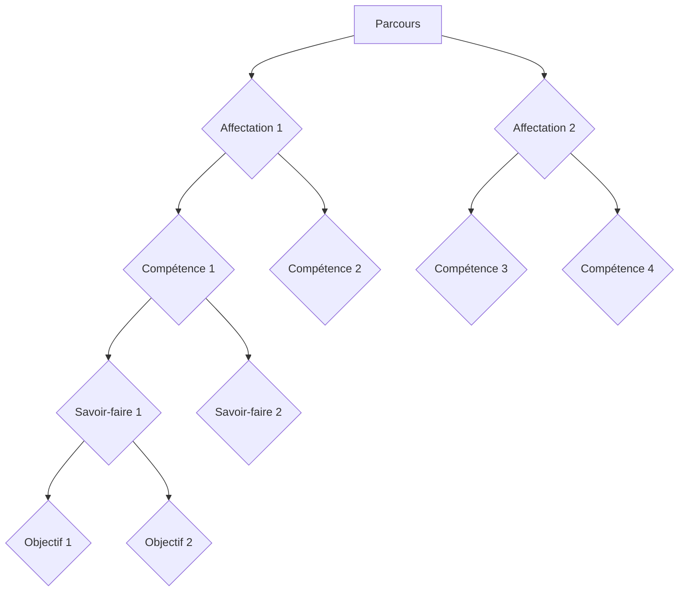

# Généralités sur le module Fcm Central

Le module Fcm Central est un module métier de l'écosystème [POSEIDON](../../index.md). Il présente donc la plupart de ses fonctionnalités sous la forme de pages Web auxquelles l'utilisateur se connecte en utilisant son navigateur Web.

Le module FCM Central permet aux utilisateurs :

- de décrire les Parcours Professionnels en Alternance (PPA) de la Formation Continue Modularisée (FCM)
- de désigner les marins devant suivre les différents PPA
- d'historiser la progression de ces marins en enregistrant les éléments de ces PPA validés au cours du temps

Ces différentes fonctionnalités générales sont accessibles au travers de différentes pages Web.

## La description des PPA

Les pages permettant à l'utilisateur de décrire les parcours sont accessibles depuis le menu "Catalogue":

Pour rappel, voici un schéma illustrant comment sont construits les PPA:

