# Tutoriel du module Fcm Central

Ce tutoriel a été conçu pour accompagner la mise en production de la nouvelle version de FFAST FCM, basée sur l'architecture technique Skeletor.

Le module Fcm Central est le module métier qui offre aux utilisateurs les fonctionnalités de suivi de la FCM. 
Il s'agit en pratique du premier module de l'écosystème [POSEIDON](../../index.html).

## Connexion

Cette procédure s'applique si vous disposiez déjà d'un compte sur le serveur FFAST FCM utilisé avant la migration vers le nouveau module de FCM.
Si vous êtes un nouvel utilisateur, vous pouvez consulter la [documentation générale sur la connexion au serveur](../../Skeletor/connexion/)

La page de connexion est accessible à l'adresse suivante: [Page de Connexion](https://ffast.intradef.gouv.fr/alfan/login).

Lors de votre première connexion, il est nécessaire de cliquer sur __Mot de passe oublié__ pour créer votre compte.  

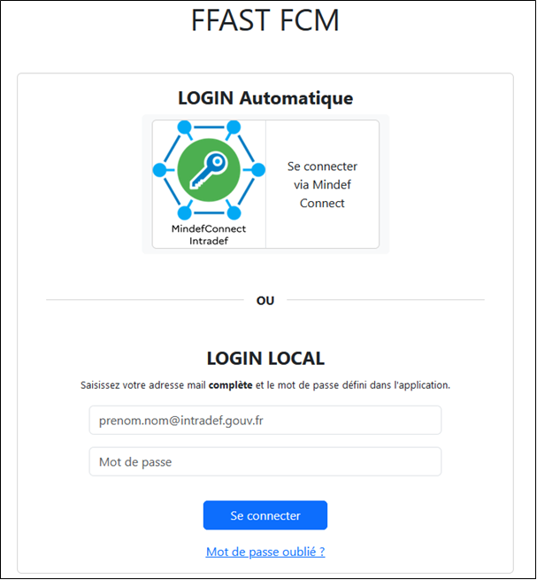

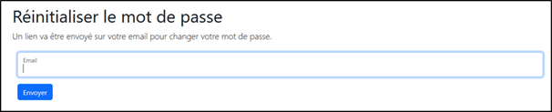

Lorsque votre compte sera créé, vous recevrez un mail de la part de ffast.notification.tec@intradef.gouv.fr
Vous devrez alors procéder à la réinitialisation de votre mot de passe.  

Il est impératif de vous connecter en utilisant MINDEF Connect pour les unités à terre ou avec votre adresse mail INTRADEF et le mot de passe que vous aurez choisi pour les unités embarquées.

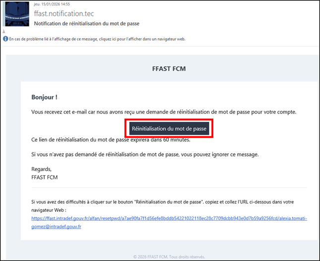

Si vous rencontrez des problèmes de visualisation et/ou de droits, veuillez-vous référer à votre FPS de rattachement.

- Brest : fps-brest-suivi-fcm.contact.fct@intradef.gouv.fr 
- Toulon : fps-toulon-suivi-fcm.contact.fct@intradef.gouv.fr 

## Navigation APPRENANT:

Tableau de bord: Ce tableau vous permet de suivre votre progression dans le parcours. 
Pour accéder à votre profil d'apprenant, cliquez sur l'option « Voir mon livret FCM »

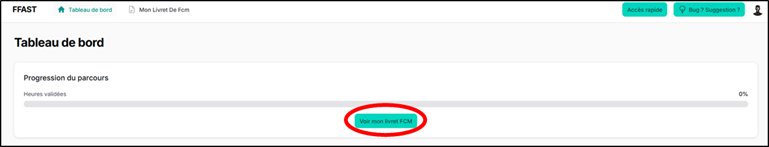

Proposer un objectif à la validation : Une fois celui-ci validé, sélectionnez l’objectif que vous souhaitez faire valider par votre mentor.

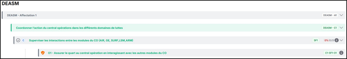

Valider une proposition : Une fenêtre s'affiche. Bien que la saisie d'un commentaire soit facultative, elle est recommandée pour justifier votre proposition. Pour finaliser, cliquez sur le bouton « Proposer ».

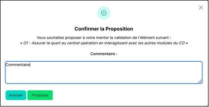

## Navigation MENTOR

Tableau de bord : Ce tableau présente la liste complète des marins dont vous êtes le mentor. 

Pour vous accompagner dans votre mission de mentor, vous avez la possibilité de télécharger le guide de mentorat. Ce document pratique répertorie les objectifs à atteindre ainsi que les points clés à maîtriser pour développer les compétences transmises par le compagnonnage en unité.

Pour consulter le livret d'un apprenant, cliquez sur l'icône bleue correspondante.

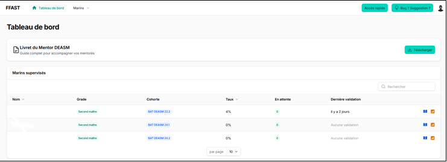

Validation : Sélectionnez l’objectif, le savoir-faire, le stage ou l’EAD que vous souhaitez valider pour votre apprenant.

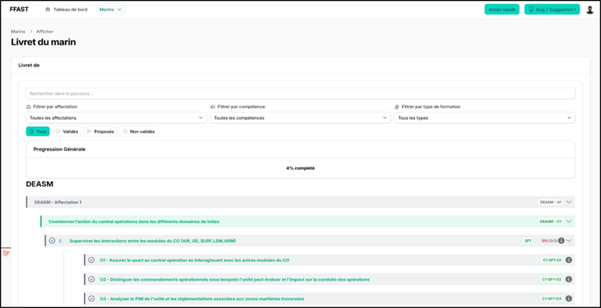

Nota : Si l’icône de validation n’apparaît pas, cela signifie que le marin est encore en sédimentation.

Confirmation de la validation : Un pop-up apparaitra pour finaliser la validation

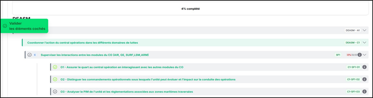

Rédaction d’un commentaire : Une fenêtre s'affiche. Bien que la saisie d'un commentaire soit facultative, elle est recommandée. Pour finaliser, cliquez sur le bouton « Valider ».

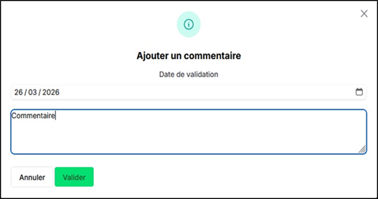

Proposition de l’apprenant : Si l’apprenant effectue une proposition, l’icône de validation s’affichera en orange, cliquez dessus pour en définir l’issue.

Valider ou refuser une proposition : Une fenêtre s'affiche. Bien que la saisie d'un commentaire soit facultative, elle est recommandée pour justifier le choix.
Pour finaliser, cliquez sur le bouton « Accepter » ou « Refuser ».

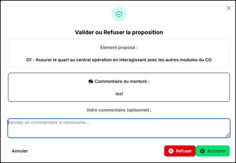

Fiche bilan FCM : La fiche bilan permet d’avoir une vue d'ensemble sur la progression de votre « mentoré ». Pour y accéder depuis le tableau de bord, cliquez sur l'icône orange

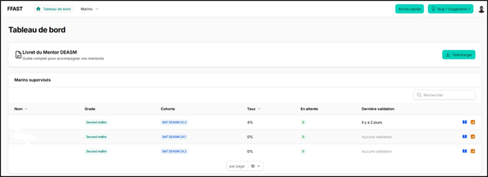

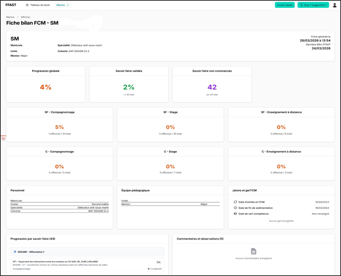

